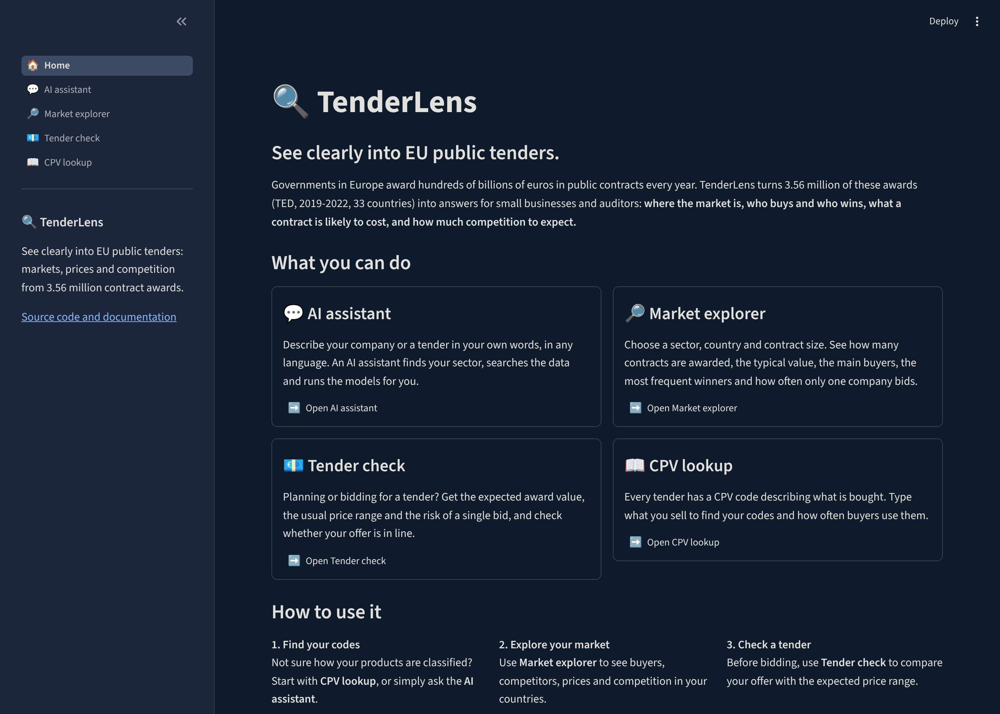
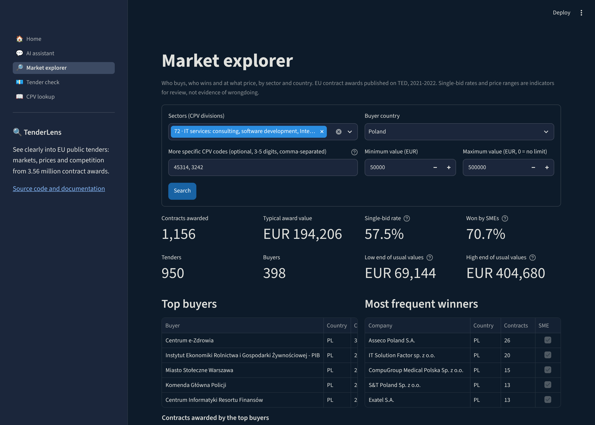
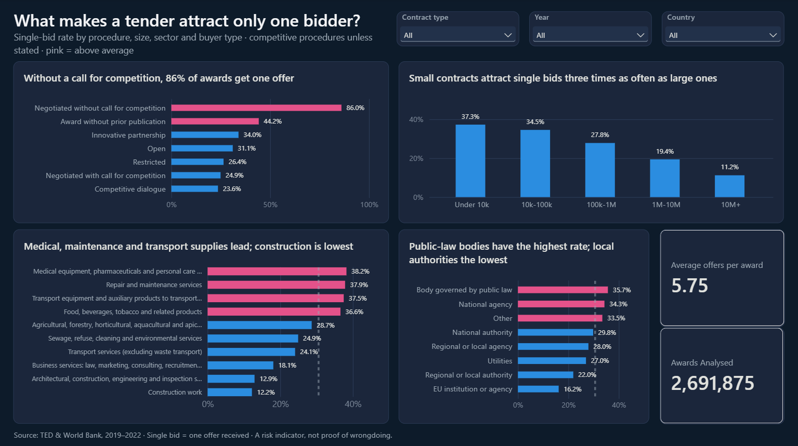
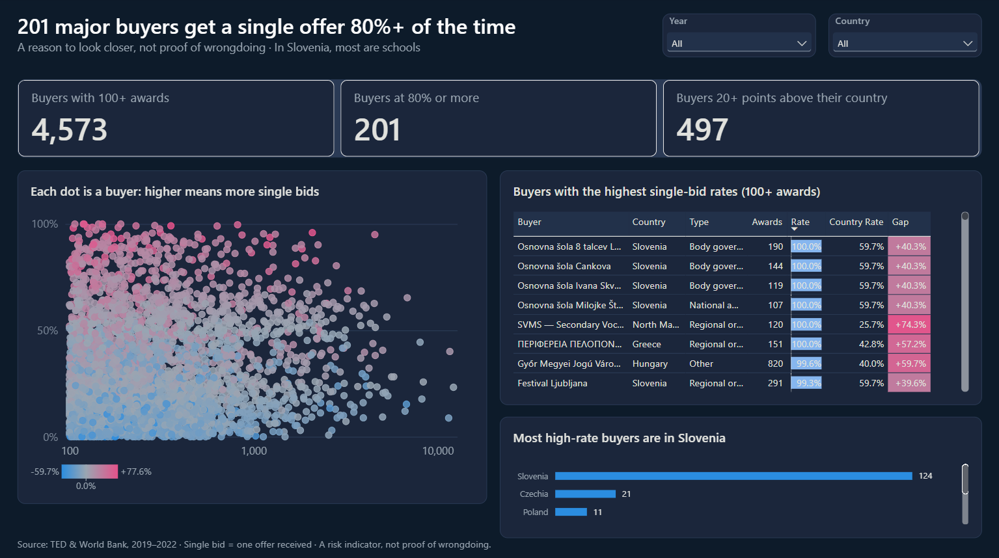

# TenderLens · Procurement Intelligence

**See clearly into EU public tenders.** An end-to-end data project on 3.56 million
EU contract awards: a data pipeline, SQL and Power BI analysis, two machine
learning models, an LLM assistant, a live web app and a monthly automated refresh.

### ▶ [Try the live app: tenderlens-eu.streamlit.app](https://tenderlens-eu.streamlit.app)



## The problem

Governments publish every contract they award: who bought what, from whom, at
what price, and how many companies competed. Hidden in millions of records:

| Problem | What TenderLens does | For |
|---|---|---|
| A third of tenders get **only one bid**: no price competition | Predicts single-bid risk **before** publication and explains why | Procurement officers, auditors |
| Weak competition and unusual prices are **hard to spot** | SQL + Power BI analysis, a monthly red-flag report | Auditors, journalists |
| **Small businesses** can't find or price opportunities | AI assistant, market explorer and price check | Small and medium businesses |

## Results at a glance

| Area | Result |
|---|---|
| **Data** | 3.56M EU awards (TED, 2019–2022, 33 countries) + 143k World Bank contracts; one-command pipeline with quality checks and a star schema |
| **Insight** | 32% of awards had a single bid, from 60% in Slovenia to 6% in Iceland; single bidding rose in 22 of 33 countries |
| **Single-bid model** | ROC-AUC 0.762 on 2022 (baseline 0.652); the riskiest 10% it flags are single-bid 73% of the time, **2.4×** the average |
| **Price model** | Typical error **26%** when the buyer publishes an estimate; calibrated 80% range covers 78.5% of 2022 awards |
| **AI assistant** | **12/12** held-out questions: right tool, sector and country, and every figure traced to the data |
| **Engineering** | 89 automated tests, leakage experiments, evaluation sets, monthly refresh with a quality gate |

## How it's built

```
 TED + World Bank open data
          │  procurement/pipeline.py: download → load → quality checks → clean → star schema (DuckDB)
          ▼
 ┌─────────────────┬──────────────────────┬─────────────────────────────────────────┐
 │ SQL analysis    │ Power BI dashboard   │ ML: single-bid risk (LightGBM)          │
 │ (sql/analysis)  │ (4 pages)            │     fair price (quantile LightGBM)      │
 └─────────────────┴──────────────────────┴───────────────────┬─────────────────────┘
                                                               ▼
                         procurement/tools.py: CPV lookup · market search · price · risk
                              │                     │                      │
                              ▼                     ▼                      ▼
                     TenderLens web app      LLM assistant (Groq)      REST API (FastAPI)
                       (Streamlit)            calls the tools          /market /price /risk

 Monthly: procurement/refresh.py → rebuild → red-flag report → new app bundle (Windows Task Scheduler)
```

## TenderLens web app

| Page | What it does |
|---|---|
| **AI assistant** | Describe your company or a tender in any language; the LLM finds your sector codes and calls the market search and both models. Every figure comes from the tools |
| **Market explorer** | Contracts, typical value, single-bid rate, SME share, top buyers and winners by sector, country and contract size |
| **Tender check** | Expected award value, 80% price range and single-bid risk of a planned tender; checks whether an offer is in line |
| **CPV lookup** | Finds the official procurement codes (9,454) for a product or service |



The app, the assistant and the API all call the same tested functions, so a figure is computed in one place
([Phase 7](docs/phases/PHASE_7_WEB_APP.md)).

## Machine learning

Both models use only information known **before** a tender is published, with a
time-based split: train 2019–2020, validate 2021, test once on 2022
([details](docs/phases/PHASE_5_MACHINE_LEARNING.md) · [model card](reports/model_card.md)).

| Model | Test result (2022) | Baseline |
|---|---|---|
| **Single-bid risk** (LightGBM classifier) | ROC-AUC 0.762, PR-AUC 0.607, lift 2.37× in the riskiest 10% | Country rate: ROC-AUC 0.652 |
| **Fair price** (LightGBM quantile regression) | Median error 26% with a buyer estimate (41% overall); 80% range covers 78.5% | Peer median: 88% error |

- **Leakage control:** the buyer's history skips the last 180 days, because award
  notices appear months after a tender is advertised; an experiment measured the
  leak this removes (ROC-AUC +0.005 without the gap).
- **Calibration:** price ranges were too narrow on later years (73% coverage);
  conformal calibration on the validation year restored 78.5%.
- **Explanations:** SHAP values for every prediction; country, the buyer's history
  and the sector drive single-bid risk.

## AI assistant

An LLM (Groq, any OpenAI-compatible provider) translates a plain-language
question into CPV codes, a country and a value range, and calls four tools: the
official CPV list, a SQL market search and the two models. It writes the
answer; it never computes figures ([details](docs/phases/PHASE_6_AI_ASSISTANT.md)).

| Version | Cases | Tool · Sector · Country | Grounded figures |
|---|---|---|---|
| With CPV lookup, before fix | 20 development | 20 · 20 · 20 | 13/20: invented price ranges in the advice |
| After fix (no figures in advice) | **12 held-out, written before the fix** | **12 · 12 · 12** | **12/12** |

Grounding is checked automatically: every number in an answer must match a
tool result. Inputs are validated and reach SQL as bound parameters.

## Analysis and dashboard

Star schema in DuckDB with SQL analysis ([notebook](notebooks/03_sql_analysis.ipynb)) and a four-page
Power BI report ([PDF](reports/dashboard.pdf) · [build guide](docs/phases/PHASE_4_POWER_BI.md)):

- Procedures without a call for competition are single-bid **86%** of the time; competitive procedures **31%**.
- Single bidding falls with contract size: **38%** under EUR 10k, **14%** above EUR 10M.
- **13.1%** of large buyers have highly concentrated spending (HHI ≥ 2,500).
- **672 companies** won both EU tenders and World Bank contracts.
- Correcting repeated joint-venture amounts removes **USD 4.4 bn** of double counting from World Bank totals.

<details>
<summary><b>Dashboard pages</b> (click to expand)</summary>

**Overview:** single-bid rates by year, country and contract type.


**Competition:** what makes a tender attract only one bidder.


**Buyers:** where an auditor should look first, each buyer compared with its own country.


**Vendors and markets:** who wins, buyer concentration (HHI) and companies in both EU and World Bank markets.


</details>

## Automation

`python -m procurement.refresh` rebuilds everything in one command: download,
quality checks (it stops if a critical rule fails), clean layer, star schema,
features, a **red-flag report** for auditors (buyers to review, riskiest tenders
with their main reasons, unusual prices, changes since the last run) and a new
app bundle. Windows Task Scheduler runs it on the 1st of each month; every run
is logged ([details](docs/phases/PHASE_8_AUTOMATION.md)). The first report found
a data-quality bug (placeholder values such as 999,999,999.99), now fixed and
covered by a test.

## Quick start (Python 3.12)

```bash
python -m venv .venv
source .venv/bin/activate              # Windows: .venv\Scripts\Activate.ps1
pip install -r requirements.txt
python -m pytest -q                    # 89 tests
streamlit run streamlit_app.py         # web app (downloads the published data bundle)
```

Rebuild everything from the source data (about 490 MB download):

```bash
python -m procurement.refresh --retrain            # pipeline, models, red-flag report, app bundle
uvicorn procurement.api:app                        # REST API, docs at http://localhost:8000/docs
python -m procurement.assistant "describe your company"   # needs LLM_API_KEY in .env
```

## Documentation

| Phase | Topic |
|---|---|
| [0](docs/phases/PHASE_0_SETUP.md) · [1](docs/phases/PHASE_1_DATA_PIPELINE.md) | Setup · data pipeline and quality checks |
| [2](docs/phases/PHASE_2_CLEANING_EDA.md) · [3](docs/phases/PHASE_3_SQL_ANALYSIS.md) · [4](docs/phases/PHASE_4_POWER_BI.md) | Cleaning and EDA · star schema and SQL · Power BI |
| [5](docs/phases/PHASE_5_MACHINE_LEARNING.md) · [6](docs/phases/PHASE_6_AI_ASSISTANT.md) | Machine learning · AI assistant and its evaluation |
| [7](docs/phases/PHASE_7_WEB_APP.md) · [8](docs/phases/PHASE_8_AUTOMATION.md) | Web app and API · automation |

[Project plan](docs/PROJECT_PLAN.md) · [Model card](reports/model_card.md) · [Data profile](reports/data_profile.md)

## Project structure

```
procurement/   Python package: pipeline, cleaning, models, assistant, tools, API, refresh
app_pages/     Web app pages (entry point: streamlit_app.py)
sql/           SQL queries, kept as .sql files
notebooks/     Exploratory and SQL analysis
reference/     Lookup tables (CPV codes, countries)
evaluation/    Test cases for the AI assistant (development and held-out)
reports/       Generated reports, metrics and figures
docs/          Project plan and one document per phase
tests/         Automated tests
scripts/       Scheduling (monthly refresh on Windows)
data/, models/ Created by the code, not committed
```

## Tech stack

Python · pandas · DuckDB (SQL) · scikit-learn · LightGBM · SHAP · Power BI ·
LLM API (Groq, tool calling) · Streamlit · FastAPI · Docker · pytest

## Data and responsible use

- [TED (Tenders Electronic Daily) CSV subset](https://data.europa.eu/data/datasets/ted-csv):
  EU contract award notices, 2019–2022.
- [World Bank: Contract Awards in Investment Project Financing](https://financesone.worldbank.org/x/DS00005):
  contracts in World Bank-financed projects, signed 2019–2022.

Both are open data; each source's terms of use apply. Single-bid rates, risk
scores and unusual prices are **indicators for review, not evidence of
wrongdoing**: a single offer or a high price can have legitimate causes.
