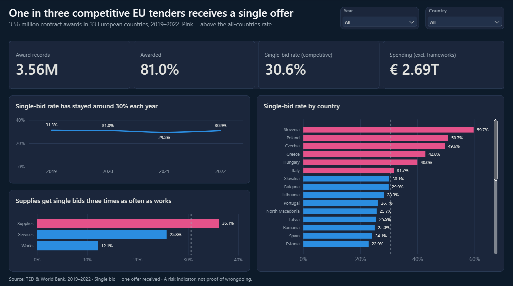
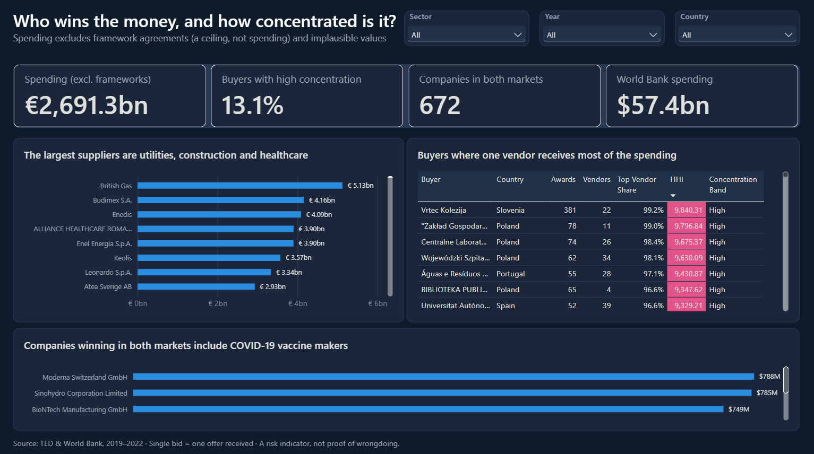

# Procurement Intelligence

**Turning public procurement data into better competition, faster auditing and
fairer access for small businesses.**

Governments publish every contract they award: who bought what, from whom, at
what price, and how many companies competed. This project turns that raw data
into answers:

| Problem | Solution | User |
|---|---|---|
| Tenders with only one bidder have no price competition | ML model predicting single-bid risk **before** publication, with explanations | Procurement officers |
| Suspicious patterns are hidden in millions of records | SQL analysis + Power BI dashboard of competition, vendor concentration and unusual prices | Auditors, journalists |
| Small businesses can't find or price opportunities | AI assistant matching a company to relevant tenders, past winners and prices | Small and medium businesses |

> 🚧 **Status: in development.** Phases 0–5 complete: project setup, a
> reproducible data pipeline, cleaning and exploratory analysis, star schema,
> SQL analysis, a Power BI dashboard and two machine learning models.

## Dashboard

Four-page Power BI report built on the star schema ([PDF export](reports/dashboard.pdf) ·
[build guide](docs/phases/PHASE_4_POWER_BI.md)).

**Overview:** how often competitive tenders receive a single offer, by year, country and contract type.


**Competition:** what makes a tender attract only one bidder (procedure, size, sector, buyer type).


**Buyers:** where an auditor should look first, each buyer compared with its own country.


**Vendors and markets:** who wins the money, buyer concentration (Herfindahl-Hirschman Index) and companies active in both EU and World Bank markets.

> See the [project plan](docs/PROJECT_PLAN.md).

## Machine learning

Two models trained only on information known **before** a tender is published,
with a time-based split (train 2019–2020, validate 2021, test 2022)
([details](docs/phases/PHASE_5_MACHINE_LEARNING.md) · [model card](reports/model_card.md)).

| Model | Test result (2022) | Baseline |
|---|---|---|
| **Single-bid risk** (LightGBM classifier) | ROC-AUC 0.762, PR-AUC 0.607; the riskiest 10% of lots are single-bid 73% of the time (lift 2.37x) | Country rate: ROC-AUC 0.652 |
| **Fair price** (LightGBM quantile regression) | Median error 26% when the buyer publishes an estimate (41% overall); calibrated 80% range covers 78.5% of awards | Peer median: 88% error |

- Buyer history skips the last 180 days so outcomes not yet public at
  advertising time cannot leak in; an experiment shows the gap removes a small
  leak (ROC-AUC +0.005 without it).
- Price ranges drifted too narrow on later years (73% coverage); conformal
  calibration on the validation year restored 78.5%.
- Every prediction is explained with SHAP values; the main drivers of single-bid
  risk are country, the buyer's history and the sector.

## Highlights so far

From 3.56 million EU contract awards (2019–2022) and 143k World Bank contracts
([full analysis](notebooks/02_eda.ipynb)):

- **32% of awarded EU contracts received a single offer**, ranging from 60% in Slovenia to 6% in Iceland.
- Procedures without a call for competition are single-bid **86%** of the time; competitive procedures **31%**.
- Single bidding falls with contract size: **38%** under EUR 10k, **14%** above EUR 10M.
- **672 companies** won both EU tenders and World Bank contracts.
- Single bidding rose in **22 of 33** countries between 2019 and 2022 ([SQL analysis](notebooks/03_sql_analysis.ipynb)).
- **13.1%** of large buyers have highly concentrated spending (HHI ≥ 2,500).
- Correcting repeated joint-venture amounts removes **USD 4.4 bn** of double counting from World Bank totals.

## Tech stack

Python · pandas · DuckDB (SQL) · scikit-learn · LightGBM · Power BI · LLM API ·
FastAPI · Streamlit · Docker · GitHub Actions

## Quick start (Python 3.12)

```bash
python -m venv .venv
source .venv/bin/activate        # Windows: .venv\Scripts\Activate.ps1
pip install -r requirements.txt
python -m procurement.check_setup
python -m pytest -q
python -m procurement.pipeline    # download and load 2019-2022 (~490 MB download)
python -m procurement.features && python -m procurement.train              # single-bid model
python -m procurement.price_features && python -m procurement.price_train  # fair price model
```

The pipeline writes a DuckDB database to `data/procurement.duckdb`, a data
profile to [`reports/data_profile.md`](reports/data_profile.md), the clean
tables `ted_awards` and `world_bank_awards`, and a star schema (two fact tables,
five dimensions) in `data/marts/` for analysis and Power BI. Details:
[Phase 1](docs/phases/PHASE_1_DATA_PIPELINE.md) ·
[Phase 2](docs/phases/PHASE_2_CLEANING_EDA.md) ·
[Phase 3](docs/phases/PHASE_3_SQL_ANALYSIS.md) ·
[Phase 4](docs/phases/PHASE_4_POWER_BI.md) ·
[Phase 5](docs/phases/PHASE_5_MACHINE_LEARNING.md).

## Project structure

```
procurement/   Python package (pipeline, models, app code)
sql/           SQL queries, kept as .sql files
notebooks/     Exploratory analysis
reference/     Small lookup tables (e.g. CPV sector names)
data/          Downloaded and processed data (not committed; re-created by code)
models/        Trained models (not committed; re-created by the training scripts)
reports/       Generated reports and figures
docs/          Project plan and one explanation file per phase
tests/         Automated tests
```

## Data sources

- [TED (Tenders Electronic Daily) CSV subset](https://data.europa.eu/data/datasets/ted-csv):
  EU contract award notices, 2019–2022.
- [World Bank: Contract Awards in Investment Project Financing](https://financesone.worldbank.org/x/DS00005):
  contracts in World Bank-financed projects, signed 2019–2022.

Both are published as open data by their respective institutions. Each data
source's own terms of use apply.
