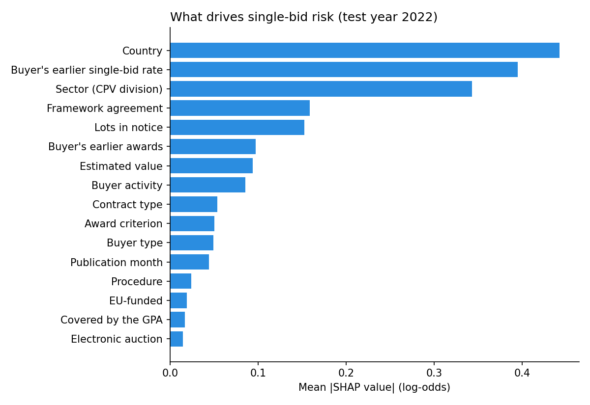
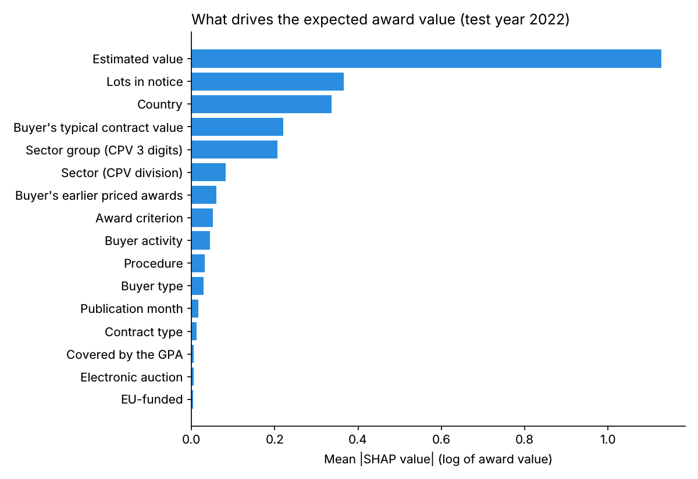

# Phase 5: Machine learning

Two models, both trained only on information available **before a tender is
published**:

| Model | Question | Type | Main users |
|---|---|---|---|
| **Single-bid risk** | How likely is this lot to receive only one bid? | Classification (probability) | Procurement officers, auditors |
| **Fair price** | What will this lot most likely be awarded at, and is the actual award unusual? | Regression (percentiles) | Small businesses, buyers, auditors |

Model card with intended use and limits: [`reports/model_card.md`](../../reports/model_card.md).

## 1. How to run

```bash
pip install -r requirements.txt          # adds scikit-learn and LightGBM
python -m procurement.features           # single-bid feature table (seconds)
python -m procurement.train              # single-bid models (~3 min)
python -m procurement.explain            # SHAP importance + example explanation
python -m procurement.price_features     # price feature table (seconds)
python -m procurement.price_train        # price models (~20-30 min)
python -m procurement.lag_experiment     # optional: buyer-history gap test (~10 min)
python -m pytest -q
```

Requires the star schema from Phase 3 (`python -m procurement.pipeline`).
Feature tables go to `data/ml/`, trained models to `models/` (both git-ignored);
metrics and figures to `reports/`.

| File | Role |
|---|---|
| `sql/ml/01_single_bid_features.sql` | Single-bid features, including the buyer's earlier single-bid rate |
| `sql/ml/02_price_features.sql` | Price features and the log award value target |
| `procurement/features.py`, `price_features.py` | Feature lists, loading, time-based split |
| `procurement/train.py` | Single-bid baseline, logistic regression, LightGBM; threshold and lift |
| `procurement/price_train.py` | Price baseline, ridge regression, LightGBM quantile models, calibration, unusual-price flags |
| `procurement/evaluate.py` | Classification, regression and interval metrics |
| `procurement/explain.py` | SHAP values (TreeSHAP built into LightGBM) |
| `procurement/lag_experiment.py` | Compares buyer-history gaps on the validation year |

## 2. Design decisions shared by both models

**No information from after publication.** The number of offers, award value,
winner and award date are only known after bidding closes. `tests/test_ml.py`
and `tests/test_price.py` fail if any of them becomes a feature. The number of
offers only defines the single-bid label; the award value is only the price target.

**Time-based split.** Train on notices published up to 2020, choose models,
early stopping, thresholds and calibration on 2021, and score 2022 once. This
matches real use (learn from the past, predict what comes next) and keeps all
lots of a notice on the same side of the split. A random split would let the
model learn from 2022 and be tested on 2019.

**Buyer history with a 180-day gap.** A buyer's past behaviour is a strong signal,
but our date is the award-notice date, months after the tender was advertised.
Only award notices published at least 180 days earlier are counted, so outcomes
that were not yet public on the advertising day are excluded.
`procurement/lag_experiment.py` tested the gap on the validation year:

| Gap | ROC-AUC | PR-AUC | Lots with history |
|---|---|---|---|
| 1 day (no gap) | 0.799 | 0.658 | 94.6% |
| 90 days | 0.795 | 0.653 | 92.5% |
| **180 days (used)** | **0.794** | **0.654** | 90.3% |
| 365 days | 0.789 | 0.646 | 86.7% |

Removing the gap raises ROC-AUC by only 0.005: the leak is real but small, and
the buyer signal mostly reflects long-term behaviour. 180 days is kept as a
cautious choice. The single-bid rate is shrunk towards the training-years rate
(20 pseudo-awards) so a buyer with two earlier awards is not treated as a
"100% buyer".

**Models from simple to strong.** A rule-based baseline, a linear model, then
LightGBM. The baseline answers "is machine learning worth it?"; the linear model
is a transparent benchmark; LightGBM learns interactions (for example small
contracts in specific countries) and handles categories and missing values
natively. LightGBM was chosen over scikit-learn's gradient boosting for speed on
2-3 million rows and native categorical splits. LightGBM settings are fixed
(learning rate 0.05, up to 63 leaves, at least 200 rows per leaf, 80% row and
feature sampling) with early stopping on 2021; no tuning on the test year.

**Explanations.** SHAP values come from LightGBM's own TreeSHAP
(`predict(..., pred_contrib=True)`), which gives exact per-feature contributions
for every prediction without an extra library.

## 3. Single-bid risk model

**Rows:** 2,691,875 awarded lots in competitive procedures with a known number of
offers. **Label:** `is_single_bid` (1 = one offer). Train 1,285,906 rows
(31.1% single-bid), validation 714,104 (29.5%), test 691,865 (30.9%).

**Features:** country, buyer type and activity, contract type, procedure, award
criterion, CPV division, framework / EU-funded / GPA / electronic auction flags,
lots in notice, log estimated value (missing when not reported or implausible),
publication month, and the buyer's earlier award count and smoothed single-bid rate.

**Results on the test year (2022):**

| Model | ROC-AUC | PR-AUC | Brier | Lift @ top 10% |
|---|---|---|---|---|
| Baseline: country rate | 0.652 | 0.437 | 0.198 | 1.67x |
| Logistic regression | 0.728 | 0.555 | 0.183 | 2.18x |
| **LightGBM** | **0.762** | **0.607** | **0.173** | **2.37x** |

- Validation (2021) ROC-AUC was 0.794; the drop to 0.762 on 2022 reflects market
  change between years and is reported rather than tuned away.
- Accuracy is not used: 69% of lots are not single-bid, so a model that always
  says "no" would score 69%.
- **Lift by review budget:** 3.07x in the riskiest 1%, 2.61x in 5%, 2.37x in 10%,
  2.07x in 20%. Reviewing the riskiest 10% finds 73% single-bid lots against 31% at random.
- **Threshold** chosen on 2021 by best F1 (31%): on 2022 it flags 37.8% of lots with
  precision 52.9% and recall 64.6%. Users with a small review budget should rank
  by risk instead.
- **Calibration:** predicted and observed rates agree within about 2 points from
  the 5th decile up; the lowest deciles are under-predicted by 2-4 points.

**Main drivers (mean |SHAP|, 2022 sample):** country, buyer's earlier single-bid
rate, CPV division, framework agreement, lots in notice.



## 4. Fair price model

**Rows:** 2,082,932 awarded lots with a plausible value (EUR 100 to 1bn, no
placeholders), excluding framework agreements, whose value is a ceiling for
future orders rather than a price. **Target:** natural log of the award value,
so a 20% error counts the same for a EUR 10k and a EUR 10M contract.

**Features:** as the single-bid model, plus CPV group (first three digits) and
the buyer's earlier priced-award count and typical contract value (mean log
value, same 180-day gap). The estimated value is missing for 39% of test lots;
LightGBM learns where missing values go at each split, the linear model uses
median imputation plus a missing-value indicator.

**Models:**
1. Baseline: median award value of the same CPV division, country and contract
   type in training (falling back to division and type, then the overall median).
2. Ridge regression on the same preprocessing as the logistic model.
3. LightGBM with **quantile loss**, one model each for the 10th, 50th and 90th
   percentile. The 50th percentile is the expected value; the 10th-90th range
   is an 80% prediction interval. Rows where the separately trained models cross
   are sorted.

**Results on the test year (2022), expected value:**

| Model | Median % error | Within 25% | Within 2x | R² (log) |
|---|---|---|---|---|
| Baseline: peer median | 88.5% | 10.9% | 28.5% | 0.366 |
| Ridge regression | 69.6% | 15.9% | 40.4% | 0.615 |
| **LightGBM (50th percentile)** | **40.8%** | **38.3%** | **60.8%** | **0.727** |

**By availability of the buyer's estimate (LightGBM, 2022):**

| Lots | Share | Median % error | Within 2x | 80% range coverage |
|---|---|---|---|---|
| Estimate differs from the award | 48.0% | 25.9% | 73.5% | 76.2% |
| Estimate exactly equals the award | 13.2% | 12.9% | 89.8% | 88.7% |
| No estimate | 38.8% | 79.4% | 35.2% | 77.9% |

In 13% of lots the published estimate equals the award value to the euro, which
suggests it was sometimes filled in after the award. These rows are kept but
reported separately (the flag is never a feature); **25.9% is the realistic error
when a genuine estimate exists.** Without an estimate, the data lacks the main
price driver, quantity, and the model is weak.

**Calibrated range.** The raw 10th-90th percentile range covered 80.5% of
training prices but only 75.2% in 2021 and 73.1% in 2022: prices drift between
years. Conformalised quantile regression on 2021 measures how far actual values
fall outside their range and widens every range by the 80th percentile of that
distance (a factor of 1.05 on each side). Applied unchanged to 2022, coverage rises
from 73.1% to **78.5%**. The median range is 12.3x wide (90th / 10th
percentile), mostly driven by lots without an estimate. 2021 also served for
early stopping, so the calibration is slightly optimistic; 2022 shows the real coverage.

**Unusual prices.** An award more than twice the 90th percentile, or below half
the 10th, is flagged: 2.7% high and 4.4% low in 2022. Low flags often point to
data-entry problems (values in thousands, a single lot reported for a whole
notice). A flag means "worth reviewing", not overpricing or wrongdoing.

**Main drivers (mean |SHAP|):** estimated value, lots in notice, country, buyer's
typical contract value, CPV group.



## 5. Limits

- Single-bid risk is a **risk indicator, not evidence** of corruption: a single
  offer can reflect a niche market, a small contract or a short deadline.
- Lots of one notice share most features, so the 691,865 test lots are less
  independent than the row count suggests.
- The advertising date is not in the dataset; the 180-day gap approximates it.
- Buyers are identified by standardised name and country; the same organisation
  under different spellings counts as different buyers.
- TED publishes no quantities, which caps how precisely prices can be predicted.
- Results come from a single run; LightGBM's multi-threaded training can change
  the last decimal places between machines.

## 6. Tests

`tests/test_ml.py` and `tests/test_price.py` (21 tests) build the feature tables
from small synthetic tables and check: no post-publication column is a feature;
only the intended rows are kept; buyer history respects the 180-day gap and the
smoothing formula; implausible estimates become missing; the year split; the
baseline fallbacks; quantile sorting; the conformal margin; the unusual-price
rule; and every metric against hand-computed values.
