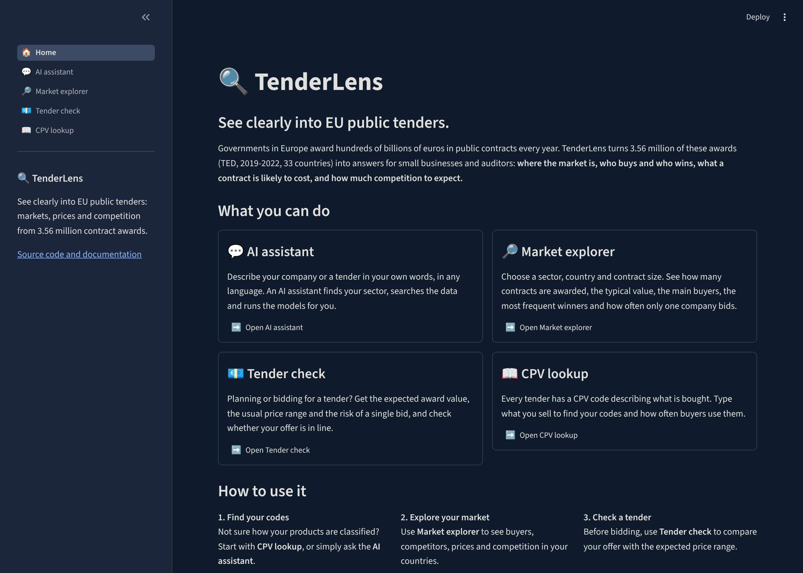

# Phase 7: TenderLens web app and API

**TenderLens** puts the project in front of users: a Streamlit web app with an
AI assistant, a market explorer, a tender price and risk check and a CPV code
lookup, plus a REST API for programmatic use. The app, the API and the
assistant all call the same tested functions in `procurement/tools.py`, so a
figure is computed in one place only.



## 1. How to run

```bash
pip install -r requirements.txt          # adds streamlit, fastapi, uvicorn
streamlit run streamlit_app.py           # web app at http://localhost:8501
uvicorn procurement.api:app              # API at http://localhost:8000, docs at /docs
python -m pytest -q
```

The app needs the **app bundle**. When it is missing, it is downloaded from
the GitHub Release `app-data-v1`. To build it from a local pipeline run
(Phases 1-5):

```bash
python -m procurement.app_bundle         # writes data/app/procurement_app_bundle.zip
```

The AI assistant page needs `LLM_API_KEY` (in `.env` locally, or in the
hosting platform's secrets); the other pages work without it.

| File | Role |
|---|---|
| `streamlit_app.py` | Entry point: page configuration, sidebar, navigation |
| `app_pages/home.py` | What TenderLens does, how to use it, key numbers |
| `app_pages/assistant.py` | Chat with the AI assistant (10 questions per session) |
| `app_pages/market.py` | Market explorer |
| `app_pages/tender.py` | Tender check |
| `app_pages/cpv.py` | CPV lookup |
| `app_pages/common.py` | Cached data connection and shared formatting |
| `procurement/api.py` | FastAPI service: `/health`, `/market`, `/price`, `/risk` |
| `procurement/app_bundle.py` | Builds the data and model bundle |
| `procurement/app_data.py` | Downloads the bundle and exposes it to the tools |
| `Dockerfile` | Container for the app (default) or the API |
| `.streamlit/config.toml` | Dark theme matching the Power BI report |

## 2. Architecture

```
GitHub Release: procurement_app_bundle.zip  (65 MB: 2021-2022 awards, buyer names, 4 models)
        │ downloaded once on start
        ▼
procurement/app_data.py ── DuckDB views ted_awards / fact_award / dim_buyer over the bundle
        │
        ▼
procurement/tools.py ──── find_cpv_codes · search_market · estimate_price · single_bid_risk
   │                 │                         │
   ▼                 ▼                         ▼
Streamlit pages   AI assistant (LLM)        FastAPI
```

## 3. Design decisions

**A small bundle instead of the database.** The pipeline produces about 1 GB
of data; the app needs only the 2021-2022 awards it searches (1.5 million rows,
15 columns), buyer names and the four trained models. The bundle is a 65 MB zip
published as a GitHub Release asset, which keeps data out of the repository and
lets any host download it. It also stores the two constants the tools need at
prediction time (the training single-bid rate and the price calibration
margin), so the deployed models always use their own values. Peak memory of
the app is about 450 MB.

**One data layer.** `app_data.connect()` creates DuckDB views with the same
names as the pipeline's tables, so the tools run unchanged on the bundle.
DuckDB connections are not shared between threads, so each page run and each
API request uses its own cursor.

**Pages for different users.** The AI assistant suits users who do not know
procurement codes; Market explorer and Tender check give direct, unlimited
access to the same functions without the LLM, so the app stays useful if the
LLM provider is unavailable. Market explorer combines broad sectors (CPV
divisions) with optional specific codes, and explains small markets instead of
showing misleading figures.

**CPV lookup.** The official CPV 2008 list (9,454 codes,
`reference/cpv_codes.csv`, published on TED) is searchable by English keywords.
Keywords match the start of words (so "bread" does not match "breakdown"),
words of up to four letters match whole ("bus" does not match "business"), and
rare words weigh more than common ones (an inverse document frequency weight,
so in "medical gloves" the word "gloves" decides). Results are ordered by how
many 2021-2022 awards use each code. The same function is a fourth tool for the
assistant, which then looks codes up instead of guessing them.

**Protecting the free LLM quota.** Each visitor can ask 10 questions per
session; provider errors show a message instead of breaking the page.

**REST API.** FastAPI with Pydantic models validates requests (invalid input
returns HTTP 422 with the reason) and generates interactive documentation at
`/docs`. Example:

```
POST /price  {"cpv_group": "45314", "country": "PL", "contract_type": "Works", "estimated_value": 200000, "lots": 2}
→ {"expected_award_value": "EUR 176,411", "range_80_percent": "EUR 157,454 to EUR 242,614", ...}
```

**Container.** The Dockerfile installs the requirements and LightGBM's OpenMP
runtime on `python:3.12-slim` and starts the app; the same image runs the API
with a different command. The image has not been built in this project's
development environment, which had no Docker daemon.

## 4. Assistant changes and evaluation

Adding `find_cpv_codes` kept tool, sector and country accuracy at 100% but
exposed invented price ranges in the closing tip of answers. The instruction was
changed so the tip contains no figures, and the change was measured on 12 new
held-out questions written before it: **12/12 on all four checks** (one run).
Details and the full version history are in the
[Phase 6 documentation](PHASE_6_AI_ASSISTANT.md#later-versions-phase-7).

## 5. A bug worth recording

Users had to send every chat question twice. Streamlit identifies a widget by
its parameters, and the chat box's placeholder contained a live question
counter; each answer changed the counter, so the next question went to a "new"
widget and was dropped. The placeholder is now constant and the counter is
shown separately. `tests/test_app.py` sends two questions in a row to keep it fixed.

## 6. Limits

- **Predictions differ slightly between machines.** Models retrained on another
  machine give the same test metrics but individual predictions can differ by a
  few percent (multi-threaded training); the deployed app uses the models in
  the published bundle. LightGBM's `deterministic` setting would make runs identical.
- **Data is from 2021-2022** and covers awards, not open tenders.
- **Free hosting** limits memory and may put the app to sleep when unused; the
  first visit after a pause takes longer while the bundle is loaded.

## 7. Tests

`tests/test_app.py` builds a small synthetic bundle and checks: the bundle views,
the one-time download, the API (`/health`, `/market`, validation errors), every
page opening without errors, the market page combining sectors and codes and
warning on empty input, the home and assistant pages, and the two-question
chat regression. `tests/test_assistant.py` covers the CPV lookup ranking and
word matching. 80 tests pass in total.
